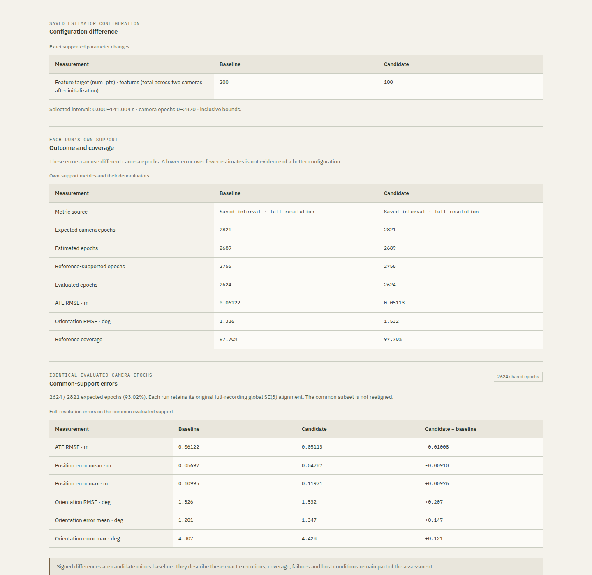

# Saved VIO comparison validation

**Validated locally and over HTTPS on 2026-10-19.**

Increment 1.6 preserves comparisons of two exact terminal runs in a private
project. The [comparison contract](../../docs/vio-comparisons.md) defines
compatibility, own and common evaluated support, unchanged global alignments,
host measurements and snapshot retention. The native estimator, dataset,
qualified configuration profile and evaluation protocol remain unchanged.

## Automated evidence

The complete numerical/core suite passes **1,128 tests**, with C++ integration
enabled and no skipped tests. The 59 comparison tests include incompatible
specifications and evidence, exact timestamps, empty intersections, partial and
missing evidence, retained full-recording alignments and repeated requests.
They do not infer scores for missing estimates.

An independent synthetic fixture gives the baseline a large error at an epoch
that the candidate drops. The candidate's own-support RMSE becomes smaller,
but its common-support RMSE remains 2 m against the baseline's 1 m. The removed
epoch appears in baseline-only support. This verifies that the two questions
remain distinct without inventing a winner. It is a test fixture, not measured
OpenVINS performance.

The complete backend suite passes **136 tests on PostgreSQL**, with no migration
drift or skipped tests. These include authenticated ownership, CSRF, terminal
states, immutable snapshots, artifact expiry and integrity, deleted sources,
project deletion and project-scoped idempotency. Two actual concurrent database
tests verify that duplicate requests create one comparison and competing
requests cannot exceed the project quota. Corrupt evidence produces an error
rather than silently falling back to recorded scalar results.

The frontend passes **223 Node tests**, the recorded-study export check and the
production build. Fixtures cover configuration and execution identities,
missing/deleted evidence, unavailable scores, partial failures, support regions,
repeated runs and escaped user content. The browser displays service-computed
scores; it does not implement an independent scorer.

## Actual baseline, variant and repetition

Three local queued executions used the same calibrated room1 recording: the
200-point baseline, a 100-point variant and a second execution of that same
100-point specification. Each published 18 artifacts. The
[independent audit](local-independent-audit.json) verified their publication
manifests and file hashes, reproduced both saved comparisons exactly, and
recomputed errors from poses/quaternions and support intersections independently.
The [unaltered snapshots](local-comparisons.json) retain their canonical analysis
hashes, exact specifications, source identities and observations.

| Observed measurement | Baseline 200 | Variant 100 | Repeat 100 |
| --- | ---: | ---: | ---: |
| ATE RMSE on common support, m | 0.06121637 | 0.05113204 | 0.05113204 |
| Orientation RMSE on common support, degrees | 1.32554139 | 1.53213662 | 1.53213662 |
| Estimated epochs / expected | 2689 / 2821 | 2689 / 2821 | 2689 / 2821 |
| Evaluated epochs / expected | 2624 / 2821 | 2624 / 2821 | 2624 / 2821 |
| First estimated epoch delay, s | 6.60034 | 6.60034 | 6.60034 |
| Native wall time on this local host, s | 46.60597 | 32.87084 | 32.92212 |

The variant has lower position RMSE but higher orientation RMSE and maximum
position error. Its common-support position RMSE delta is −0.01008433 m;
orientation RMSE increases by 0.20659522 degrees and maximum position error by
0.00975966 m. These observations do not define a universally better setting.
There are no exclusive support epochs in this pair: each run has 132 epochs
without estimates and 197 without evaluated errors. Own and common-support
scores therefore agree here. The dropped-support fixtures above test the case
where they must differ.

The baseline trajectory SHA-256 remains
`d2a59ed328807d54af0a930006b7c2e850998c2dc7d6f89debd1c195ca4ed764`,
identical to the qualified reference. The two 100-point trajectories have the
same SHA-256,
`5640a2349c71c67c1ffeda44a59b0226cb8d5f9ea86ec58d068a78b30660462e`.
Their numerical deltas are zero while the separate host-cost observations
differ. Two runs do not establish statistical repeatability or a speed guarantee.

Three new HTTPS jobs on release `20261019-0169017b1bec` produced the same
trajectory bytes, support and numerical metrics as their corresponding local
runs. Their [saved snapshots](hosted-comparisons.json) and
[independent audit](hosted-independent-audit.json) verify all 54 artifacts,
reproduce both comparisons exactly and match the canonical analyses and job
results against the original HTTPS response bodies. Native wall times on the
VPS were 76.87790, 54.88058 and 53.25400 seconds respectively. Host costs remain
separate observations; numerical agreement here does not guarantee future
cross-hardware byte identity or establish flight performance.



*An unmodified HTTPS capture of the baseline and variant comparison.
[Capture and data attribution](../../docs/media/README.md).*

## Browser checks

Both local and HTTPS applications pass **29 comparison checks and 49 workspace
regression checks**, with normal TLS validation for HTTPS. The
[check record](checks.json) lists the exact assertions: uncertain
submission and idempotent retry, saved deep links, private ownership, source and
comparison deletion, cancellation, loss of session credentials, real investigation links and
decoded stereo images. Desktop and 390 px views have no page overflow, uncaught
JavaScript errors or CSP violations; wide evidence tables remain keyboard-scrollable.

Two local harness issues were corrected without changing application code:
Playwright label selection was replaced with accessible-role selection, and
snapshot equality was made independent of PostgreSQL JSONB key order. The
remaining assertions resumed on the same real jobs and saved comparisons.
Earlier interrupted reports were preserved. Canonical hash validation uses
Django/Python snapshot captures because browser JSON serialization can normalize
`1.0` to `1`; it does not substitute reserialized browser data for the original
hashed bytes.

The HTTPS script ran completely from account creation through three new native
executions, saved comparisons, deletion checks and loss of session credentials.
Clearing cookies verifies the signed-out view; it does not test server-side
session expiry. The initial
variant creation response contained 30,606 decoded bytes and was observed after
approximately 1,291 ms; its idempotent recovery took 59 ms and returned the same
analysis identity. The repeated-run comparison took 1,053 ms and returned 30,531
bytes. These timings include transport and Playwright instrumentation with the
exact scopes recorded in the check record. They are not isolated server timings,
a controlled benchmark or latency guarantees.

## Runtime and delivery status

The [local deployment record](deployment-health.json) verifies the additive
`0004_run_comparisons` migration, preserved database container identity, image,
start time and mounts, and four healthy services. The comparison API and worker
images contain the same scientific source as the workspace: 31 API and 38 worker
files were compared by SHA-256. The same [80-file source bundle](source-manifest.json)
is active on the VPS as release `20261019-0169017b1bec`; its runtime sources match
the committed implementation. The remote database identity and existing mounts
were preserved through the additive migration as well.

The [API cgroup observation](api-resources.json) recorded a peak of 214,872,064
bytes under its 512 MiB limit, with no memory-limit or OOM events. This peak
covers container startup and all local QA requests, including comparisons of two
full investigation artifacts. It is not a per-request measurement or a sustained
multi-user capacity claim; local comparison creation latency was not separately
recorded. No new raw-data mount or numerical dependency was added to the API.

Four exact disposable QA accounts, their six sessions, three retained jobs and
two comparisons were deleted after evidence capture. The 13 accounts, four
projects and three experiments present before the checks were preserved, as
were aggregate submission budgets. Normal collection removed the QA artifacts
and scratch; no computation child remained. The runtime scratch keeper remains
active. Its pre-existing stopped state had caused the local worker's tmpfs guard
to refuse work; restoring that keeper preceded this validation. The dedicated
test database was removed separately from the application database.

The VPS API reached a lifetime cgroup peak of 211,898,368 bytes under the same
512 MiB limit, with no memory-limit events, OOM events or restarts. After evidence
capture, four exact hosted QA accounts, their four sessions, three retained jobs
and two comparisons were removed; aggregate submission budgets were preserved.
No computation child, published artifact or scratch entry remained. All four
Meridian services were healthy and all four checked sites on the shared host
returned HTTP 200. These resource observations include startup and QA activity;
they do not isolate comparison costs or establish sustained capacity.

The remote preflight initially received an explicit Docker `No such image` for
the qualified native runtime, before creating or activating a new release. Its
absence has no established cause. After a temporary SSH relay outage, the exact
622,435,670-byte archive was verified and restored, including its OCI manifest,
configuration identity and 11 layers; no estimator rebuild or pin change was
introduced. The [restoration record](native-restoration.json) and
[deployment record](deployment-health.json) retain this sequence. A worker
heartbeat alone does not establish runtime-image availability.

The [live isolation record](child-isolation.json) covers the three actual native
and three independent evaluation containers on the VPS. Native sensor-only
inputs remain separate from reference poses; the evaluator receives six explicit
read-only files and an output directory, with no camera image tree. Existing
network, memory, CPU and process limits remain in place. These are observations
of the executed reference profile, not a new capability to run arbitrary code.

## Reproduce the checks

Install the pinned development dependencies and build C++ as described in the
[repository setup](../../README.md#technical-setup), then run:

```sh
MERIDIAN_CPP_BINARY="$PWD/build/cpp/meridian_ekf_replay" .venv/bin/python -m pytest -q -ra
npm --prefix web test
npm --prefix web run check:studies
npm --prefix web run build
```

The [workspace setup](../../docs/hosted-workspace.md) describes the PostgreSQL
environment for `python server/manage.py test workspace --noinput`. Apply the
additive comparison migration and provision the qualified worker, recording and
investigation mounts using the [deployment guide](../../docs/workspace-deployment.md).
On an operator-authorized instance with Playwright and Chromium available:

```sh
node web/scripts/check-workspace-comparisons-browser.mjs \
  http://127.0.0.1:8090/ outputs/comparison-browser
```

The script creates disposable accounts, a project, two configuration versions,
three actual VIO executions and one cancelled request. It interrupts one
accepted comparison response to exercise an unchanged idempotent retry.
Results and execution states are not mocked. Its report retains exact created
identities for evidence extraction and operator cleanup; credentials remain in
memory. Retained successful jobs and comparisons must be cleaned up explicitly.

## Interpretation limits

This increment compares the maintained TUM-VI room1 profile and its supported
feature budget. Room2 remains reserved; arbitrary recordings, estimator code,
automatic tuning and statistical run aggregation are outside this increment.
Common-support errors retain each run's original alignment and do not measure
accuracy on the epochs it omitted. Host duration and memory observations do not
establish embedded, real-time or flight performance. Independent reproduction
downloads remain the next increment.
