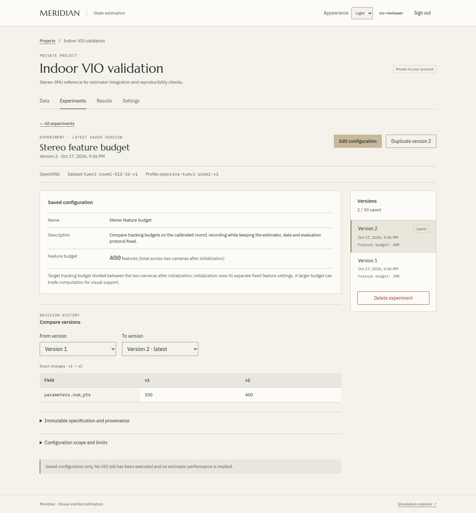

# Versioned experiment validation

Checked on **2026-10-17** for increment 1.3. The implementation supports private
experiment creation, immutable revisions, duplication, exact configuration
differences and consumption of a stored specification by the local reference
runner. It does not add hosted computation or a parameter-optimization campaign.

The [experiment contract](../../docs/versioned-experiments.md) defines the API,
supported profile, limits and lifecycle. The initial parameter is the OpenVINS
`num_pts` feature budget: 100, 200 or 400. All dataset, calibration, runtime,
scheduling, evaluation and resource settings are pinned by the profile.

*Fictional account and project, real saved revisions; no estimator execution is
shown. [Capture provenance](../../docs/media/README.md).*

## Backend and concurrency

The full numerical/core suite passed **979 tests**, with C++ integration enabled;
203 of these cover the VIO data, evaluation, runner and specification paths.

The complete backend suite passed **63 tests on PostgreSQL**. New cases cover
schema/type/identity rejection, retained historical snapshots, metadata-only
revisions, no-op saves, quotas, exact historical duplication, atomic rollback,
deletion, configuration differences, CSRF and ownership of every new route.
Saved revisions are read without rebuilding against a newer profile.

The frontend passed **188 Node tests** and its production build. The browser
check passed **49 checks** both on the local container stack and on the final
deployment over HTTPS from a separate Linux workstation, including create/edit/no-op,
historical deep links, historical duplication, exact differences, a real 409
conflict with draft preservation, explicit adoption of the latest base and
consistent history after adoption, seven cross-account experiment-route checks,
mobile layouts and the existing workspace
and explorer checks. No uncaught JavaScript error or CSP violation was observed.
Intentional negative HTTP responses remain visible in the browser console.

Three additional tests use independent PostgreSQL connections and real row locks:

- Two edits from the same base produce one success and one version conflict,
  with exactly one additional revision.
- Creation and duplication competing for the last slot produce one success
  and one quota rejection.
- Project deletion competing with experiment creation completes without a
  foreign-key error or orphaned revision.

The migration only adds tables and constraints. Existing accounts, sessions and
projects retain their schema. The API image shares the standard-library
specification module with the runner, without numerical dependencies or Docker
access. Hashes identify content; all access remains scoped to the project owner.

## Hosted deployment

Release `20261017-c4cf772c27bc` serves the
[HTTPS preview](https://meridian.151.80.144.150.sslip.io/). Its
[source manifest](source-manifest.json) records SHA-256 identities for the 53
allowlisted source files, the release archive and both application images.
The additive migration `0002_versioned_experiments` was applied successfully.
The existing PostgreSQL container and data volume were retained during both
application updates. The final browser checks above exercised this release.

A separate persistence check created an account, a project, two revisions
(200 then 100 points) and a copy of the historical first revision through HTTPS.
After restarting only the API container, the existing session, exact saved
specifications and hashes, history, difference and duplicate remained unchanged.
The PostgreSQL container ID, mounts and start time remained unchanged. This checks
application restart persistence, not database backup restoration.

The five exact test accounts from the two remote browser runs and persistence
check were then removed, along with their sessions and test records. Old test
credentials and the retained session were rejected. The preview and the other
applications sharing the server still returned HTTPS 200.

## Local native integration

A real HTTP client created an experiment through the containerized API and
PostgreSQL, changed its budget from 200 to 100, and read both versions back.
Version one remained unchanged. The exact `specification` object returned for
version two was passed to the local CLI without reconstruction or modification.
Its canonical SHA-256 remained identical in the persisted revision and execution
artifacts:

`98e780babbc5fd1b8214a3afbe65e5b5dbe39196017a83361b93f7f7cd3e5f73`

The [100-point specification](specification-100.json),
[200-point specification](specification-200.json) and
[machine-readable observations](summary.json) retain the input identities,
actual outcomes and artifact hashes. Run them with the pinned environment using
the [reference commands](../../docs/vio-reference.md#reproduce-the-qualification)
and the additional `--specification` argument.

| Observation | Baseline 200 | API-saved variant 100 |
| --- | ---: | ---: |
| Position ATE RMSE, m | 0.06121637 | 0.05113204 |
| Orientation RMSE, degrees | 1.32554139 | 1.53213662 |
| Estimated camera samples | 2689 / 2821 | 2689 / 2821 |
| Evaluated camera samples | 2624 / 2821 | 2624 / 2821 |
| First estimate delay, s | 6.600339685 | 6.600339685 |
| Native wall time, s | 46.1162 | 32.8097 |
| Native peak RSS, KiB | 81688 | 81120 |

Both executions completed and passed the existing integration sanity criteria.
The 200-point trajectory was byte-identical to the original three qualification
runs (`d2a59ed328807d54af0a930006b7c2e850998c2dc7d6f89debd1c195ca4ed764`).
The 100-point trajectory had SHA-256
`5640a2349c71c67c1ffeda44a59b0226cb8d5f9ea86ec58d068a78b30660462e`.
Prepared inputs remained unchanged; effective configurations and their hashes
were retained separately from the original calibration/configuration files.

These are single integration executions on the same handheld room1 sequence,
using the original independent-reference protocol and one recorded host. The
lower position error of the 100-point variant accompanies a higher orientation
error; it does not select a universally better configuration. Timing is a local
observation, not a hosted or embedded performance guarantee. The 400-point value
has validation/rendering checks but no native execution in this increment.
Room2 remains reserved and unevaluated. No drone, closed-loop or flight evidence
is introduced.

## Reproduction and limitations

Backend commands are in the [workspace guide](../../docs/hosted-workspace.md).
The VIO unit/integration tests cover strict pins and types, canonical identities,
rendered configuration and refusal of conflicting runtime/resource overrides
before execution. Native checks above separately establish that the supported
specification actually reaches the maintained estimator.

An experiment may contain 50 revisions and a project 20 experiments. Deleting an
experiment deletes its history; there are no attached jobs or project results
yet. The immutable contract applies through application operations, not against
an administrator directly editing the database. Authentication, account recovery
and backup limitations remain those of the hosted preview.
