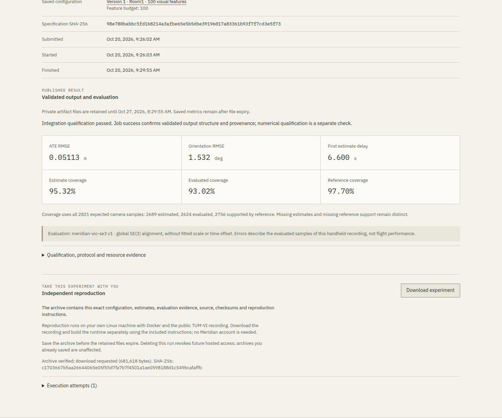

# Independent experiment export validation

**Validated locally and over HTTPS on 2026-10-20, including independent
reproduction of both exports after their source executions were deleted.**

Increment 1.7 adds a private download for one successful retained VIO execution.
The [export contract](../../docs/vio-exports.md) defines the ZIP inventory,
original execution identity, source/build recipe and numerical reproduction
criteria. It does not change the estimator, dataset, supported feature budgets
or evaluation protocol.

## Automated checks

The complete numerical/core suite passes **1,187 tests**, with C++ integration
enabled and no skipped tests. The 59 new tests exercise archive versions,
complete inventories, hashes, links and unsafe paths, bounded decompression,
private metadata rejection, source/protocol bindings, standalone verification,
exact support and numerical tolerances. Synthetic fixtures include dropped
samples, incorrect poses and changed evaluation rules; they do not substitute
for measured reproduction.

The backend passes **157 tests on PostgreSQL**, with no skipped tests or migration
drift. The 21 new HTTP-boundary tests verify authentication and both ownership
relations, strict format selection, bounded descriptor reads, corruption,
missing evidence, file/link types, account/project/job deletion and expiration.
Deletion or expiration during archive assembly prevents a response that has
not yet been sent. The boundary fixtures replace archive construction; the
scientific tests and actual downloads exercise the archive implementation.

The frontend passes **232 Node tests**, the saved-study consistency check and
production build. Download handling checks the attachment name, MIME type,
length and SHA-256 before saving, with a 16 MiB bound, retry feedback and guards
against late responses after navigation or logout.

## Export and replay protocol

The archive contains 13 exact result/configuration files, 24 standalone source
and documentation files, a launcher and one schema-versioned manifest. Every
payload member has a SHA-256 and byte size. The original result also retains
hashes of artifacts intentionally excluded from the export, including logs and
investigation data. Raw images/IMU/reference samples, free-text project/account
fields, service credentials and private host paths are not bundled.

Each actual browser exercise uses the supported **100-point variant**. It saves
the ZIP and exact response evidence before deleting the successful source job.
Independent replay then uses the saved archive outside the service. The
qualification environment was created with separately acquired public room1
data, a new Python environment and an explicitly rebuilt native image.
The original immutable experiment specification is preserved; the hosted replay
reuses that independently verified environment in a new output directory.

The required tolerances are 1 mm maximum direct position difference and
0.001 degree maximum direct orientation difference, with no additional fit.
Position ATE RMSE must agree within 1 mm, and orientation RMSE within 0.001 degree.
Estimated/evaluated timestamps, support counts and missing intervals must match.
Each evaluation retains the original full-recording unit-scale SE(3) protocol.
Runtime duration and RSS are observed separately, with no speed guarantee.

## Measured local reproduction

The local browser passed **24 export checks and 49 workspace regressions**.
The downloaded 681,589-byte ZIP has SHA-256
`c6d67f1b722c327c0bc215a89829927a1aca380421b61f09b3c7f9076db330a0`.
Repeated downloads produced identical bytes. The successful source execution
was then deleted through the UI; detail and export requests returned 404.

The [archive audit](local-export-audit.json) verified all 38 payload files,
the original specification and the result's relationship to the exact API
response. The [independent replay audit](local-reproduction-audit.json) verified
the export again and all 5,651 prepared input files, totaling 1,696,791,755 bytes.
The trajectory was byte-identical, with identical timestamps and evaluation
support. Both direct pose differences and metric differences were zero in this
execution. Position ATE RMSE was 0.051132041394887494 m and orientation RMSE was
1.532136616154553 degrees, over 2,624 evaluated poses from 2,689 estimated poses
and 2,821 expected epochs.

Replay used an extracted bundle outside the checkout, a new Python 3.12
environment containing NumPy 2.5.3 and pip, and no account, backend request or
service environment variables. Imported Meridian modules came exclusively from
the archive. The source-built native image had the distinct identity
`sha256:213dad232a508955fcaf80452dbf10f696981eb1562e5ac5eb9f8faae75bb82d`;
the original specification remained unchanged. The final build invocation from
the exported source tree reused layers from the preceding uncached build.
This was not a new Docker daemon or a second physical development machine.

The complete CLI invocation took 78.38 seconds, including preparation, integrity
checks, native execution and evaluation. It is an observed duration for one
execution, not a performance threshold. The independent audit recomputed RMSE
from per-sample evaluation errors and compared raw poses; it did not implement
a second full SE(3) evaluator.

Chrome/CDP exposed an empty response body for the attachment despite a valid
browser download. The harness records that instrumentation limitation and
compares the saved bytes with the real response headers and a separate
authenticated HTTP response. Nonempty divergent bodies still fail. Two earlier
harness interruptions were retained, and the local assertions resumed on the
same actual execution without changing application code.

## Hosted download qualification

Release `20261020-16ef0733a9c8` passed a fresh complete **24-check export workflow
and 49 workspace regressions** over HTTPS with normal certificate verification.
Its new 100-point execution produced a 681,618-byte archive, SHA-256
`c1703667b5aa26644065e05f55d7fa7b7f4501a1ae0598188d1c549bcafafffc`.
Two downloads were identical. The source was deleted through the interface and
subsequent detail/export requests returned 404. The browser checks cover
unauthorized and other-account access, unavailable active/cancelled runs,
unsupported versions, interrupted download and retry, keyboard use, refresh,
navigation and real server logout, and desktop/mobile light/dark layouts.
No uncaught browser or CSP errors occurred.

Observed download durations were 733.55 and 389.98 ms on HTTPS, compared with
640.31 and 322.85 ms locally. These measure the browser request event through
the download event and CDP body-read attempt, including network, browser hashing
and automation overhead; the separate HTTP verification request is excluded.
They are not isolated server timings or a latency guarantee.
The [check record](checks.json) preserves the assertions, exact headers,
download hashes, timing scope and instrumentation limitations.

The [hosted archive audit](hosted-export-audit.json) verified all 38 payloads,
all 24 sources and the exact execution's API evidence. A second independent
replay then executed the hosted bundle in a new output directory, reusing the
previously acquired and verified public prepared data, the same external Python
environment and the same source-built native image. It required no account or
private backend request. This was not a second fresh dataset download or a
second independently provisioned machine.

The [hosted reproduction audit](hosted-reproduction-audit.json) passed with
byte-identical trajectory, identical timestamps/support/missing regions, zero
direct pose differences and zero differences in independently recomputed RMSE.
The hosted source had the same 100-point numerical outcome as the local source.
Neither reproduction changes the original specification or claims that its new
native image is the original image.



The screenshot is an unedited capture of the real hosted execution and download.
[Capture details and dataset attribution](../../docs/media/README.md).

## Source-build reproducibility

A fresh public download obtained the exact 1,707,110,400-byte room1 archive,
SHA-256 `20354392eab5cc82c9770ed29cf0130c5acce0db54a257571499008fb34c398f`.
The initial uncached native build reproduced the estimator binaries but selected
newer `git-man` manual pages through the package dependency resolver. Pinning
`git-man=1:2.43.0-1ubuntu7.3` alongside the existing `git` pin restored the recorded
installed-package inventory in a second uncached build. Hosted execution keeps
its original qualified image and immutable runtime specification.

The rebuilt image is a new identity, even when its estimator binaries and
recorded dependency inventory agree. The recipe still depends on public source
and package availability; it does not guarantee identical future builds or
cross-hardware numerical identity. Missing pins and changed dependencies fail
explicitly. The [build and isolation record](source-build.json) preserves the
observed identities, source hashes and environment checks.

## Deployment, resources and cleanup

The [source manifest](source-manifest.json) binds all 101 deployed source files
and the 24-file export payload to the reviewed tree. API and worker source
inventories also match. Export assembly adds no database migration or persistent
archive storage. The API still has no NumPy, Docker CLI or Docker socket.
Live [native/evaluator inspection](child-isolation.json) confirmed that the
estimator had no reference poses, network or application credentials.

The [API resource observations](api-resources.json) record peaks of
175,357,952 bytes locally and 164,319,232 bytes on the VPS, within the 512 MiB
container limit, with no OOM events or restarts. These are container-lifetime
peaks covering startup and requests, not isolated export memory costs.

The [deployment and cleanup record](deployment-health.json) confirms healthy
services, preserved database identity/mounts/migrations and pre-existing records,
unchanged DNS and four existing HTTPS sites returning 200. The four disposable
accounts in each environment, their remaining QA records and sessions were
removed. The source jobs had already been deleted through the interface.
Aggregate submission budgets were preserved; no computation children, attempt
artifacts or scratch files remained. The dedicated PostgreSQL test container and
its own volume were removed without touching the application database.

The existing host cleanup had deleted the qualified native image as an unused
image. Its exact saved archive was restored, and an inert, never-started
container now references it. [Recovery evidence](native-runtime-retention.json)
records the identity and inspected cleanup filters. No shared-host cleanup
policy changed; survival of the next scheduled cleanup has not yet been
observed.

## Reproduce the checks

Run the [repository checks](../../README.md#technical-setup), including the
PostgreSQL workspace suite. With an operator-authorized hosted or local stack,
Playwright/Chromium available and computation enabled:

```sh
node web/scripts/check-workspace-exports-browser.mjs \
  http://127.0.0.1:8090/ outputs/export-browser
```

The script creates disposable accounts, a project, one actual 100-point execution
and a cancelled request. It retains the downloaded archive and exact response
bodies, deletes the successful source request and verifies that hosted export
access is revoked. The cancelled request remains for operator cleanup.
Account/project cleanup is an explicit operator action after evidence capture;
aggregate submission budgets must remain intact.

Extract the saved archive in a new directory and follow its included
[source reproduction recipe](../../integrations/reproduction/README.md). A
Meridian account, database and private backend endpoint are not required for
that process. Preserve the separately received archive digest; embedded hashes
are integrity checks, not signatures.

## Interpretation limits

This increment covers successful complete retained executions on the maintained
room1 profile. Failed, cancelled, expired and incomplete jobs do not offer a
complete reproduction download. Already downloaded bytes remain usable after
hosted deletion; deleting an account cannot recall those files.

Reproducing a result does not establish estimator accuracy, flight suitability,
real-time execution, statistical confidence or universal portability. Room2 and
the complete multi-user hosted acceptance exercise remain the next increment.
