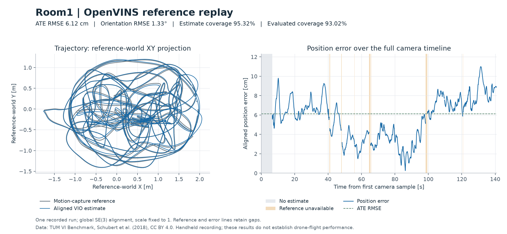

# OpenVINS reference qualification on TUM-VI room1

**Increment 1.1 qualified on 2026-10-17.** Three executions of the pinned,
sensor-only OpenVINS adapter passed the predeclared integration gates and
produced byte-identical trajectory CSVs. This is an offline, local VIO
integration on one handheld sequence. The hosted workspace is not implemented.



The figure uses run 1's recorded alignment and errors. Its left panel projects
positions into the reference world's XY plane; its right panel shows the 3D
position-error norm over the full camera timeline. Reference gaps and the period
before the first estimated pose remain visible.

## Recording and protocol

The input is the calibrated TUM-VI `room1` EuRoC-format `512_16` archive,
SHA-256 `20354392eab5cc82c9770ed29cf0130c5acce0db54a257571499008fb34c398f`,
1,707,110,400 bytes. Its official MD5 also matched. The prepared inputs contain
2,821 paired stereo timestamps, 28,122 IMU samples and 16,541 independent
motion-capture poses over about 141 seconds. `room2` remains unevaluated.

The [execution and evaluation protocol](../../docs/vio-reference.md) was fixed
before the first run. Reference interpolation is limited to brackets no wider
than 20 ms; estimates are never gap-filled. One global SE(3) alignment removes
constant world rotation and translation, with scale fixed to one. No time offset
is fitted by the evaluator. Position and orientation errors use the same
alignment and weight each evaluated camera sample equally.

Although this room sequence has motion-capture coverage across its duration,
individual reference gaps still exist. The longest is 1.058333 seconds. The
20 ms bracket rule leaves 65 camera timestamps without reference support. This
reduces evaluated coverage; it is not treated as zero error or an estimator failure.

## Observed results

All three runs have the same numerical results:

| Quantity | Observed value |
| --- | ---: |
| Position ATE RMSE after alignment | 0.06121637 m |
| Maximum aligned position error | 0.10994902 m |
| Orientation RMSE after alignment | 1.32554139 degrees |
| Estimated camera poses | 2,689 / 2,821 (95.3208%) |
| Reference-supported camera samples | 2,756 / 2,821 (97.6959%) |
| Evaluated camera samples | 2,624 / 2,821 (93.0167%) |
| First-pose delay | 6.600339685 s |
| Missing estimated poses after initialization | 0 |
| Stereo pairs processed | 2,821 |
| IMU samples consumed | 28,117 / 28,122 |

The first 132 camera samples precede the first output pose. The five unused IMU
samples are beyond the final required camera bracket. Every camera pair had an
IMU bracket. Initialization used sensor observations, with no reference state.

The loose integration gates were ATE RMSE ≤0.5 m, orientation RMSE ≤15 degrees,
estimate and evaluated coverage ≥90%, reference coverage ≥95%, at least 100
evaluated samples, and first-pose delay ≤10 s. All passed without tuning a variant
or revising a gate after seeing the result. These are integration checks, not
mission requirements or an accuracy guarantee for other data.

## Repetition and resource measurements

| Run | Native wall time (s) | Native CPU time (s) | Peak native RSS (KiB) | Container wall time (s) |
| --- | ---: | ---: | ---: | ---: |
| 1 | 49.096825 | 48.973828 | 83,880 | 49.424724 |
| 2 | 48.497951 | 48.638029 | 84,076 | 48.841221 |
| 3 | 48.497199 | 48.610517 | 84,180 | 48.849677 |

The host was Linux/WSL2 x86-64 on an Intel Core i5-12400F. The reference uses
one computation thread, with a container allowance of 2 CPUs, 4096 MiB memory,
128 processes, 128 MiB temporary storage and 900 seconds wall time. Peak native
RSS was about 82 MiB; this excludes container-wide filesystem cache and is not
a hosting memory requirement. Input and output storage and image footprint must
also be budgeted. These local timings do not establish embedded real-time behavior.

Prepared file content is 1,696,791,755 bytes. Each run produces 1,706,779 artifact
bytes excluding its final result manifest; most are provenance and evaluation
records. The runtime image is about 1.80 GB. Temporary filesystem occupancy was
sampled in a separate [resource probe](tmpfs-measurement.json): all 226
observations reported 0 bytes used in `/tmp`, with a median interval of 0.203 s
and a configured cap of 128 MiB. This sampled maximum can miss shorter
transients. The probe reused the same image, configuration and inputs and
produced the same trajectory hash; its monitoring overhead excludes it from
the three baseline timing runs. The local output bind mount has no storage
quota. Hosted quotas and operational limits remain future work.

All trajectory files have SHA-256
`d2a59ed328807d54af0a930006b7c2e850998c2dc7d6f89debd1c195ca4ed764`.
The repeated timestamps and stored poses are byte-identical. The comparison's
quaternion `acos` calculation reports about 0.000002415 degrees from floating-point
roundoff even for these identical quaternions; this is not observed estimator
variation. The predeclared repeat tolerances were 1 mm and 0.001 degrees.

## Provenance, checks, and reproduction

- OpenVINS: `69488123ed9362dd44b6f28e7f4680abbff1442b`.
- Runtime image: `sha256:73e1213d073ce52a9a509decb15628a7c043e0690609171c4b9382ed0c2730da`.
- Common run specification: `ebe6853071cc4fa3075aa6c63a1643b2dac27c5da10e962dc41fede23c437446`.
- [Machine-readable summary](summary.json): gates, measured results, configuration,
  dataset/runtime identities, artifact hashes and repetition evidence.
- [Installed dependency versions](dependency-versions.txt): exact resolved package
  manifest for the tested runtime. Its hash is recorded in the run specification.
- [Native integration](../../integrations/openvins/README.md): build and source
  notices. Runtime layers exclude upstream benchmark references and Git objects.

The full Python suite passed **890 tests**, with the existing C++ replay executable
enabled. The 114 focused VIO checks cover data separation, hashes, malformed
archives and timestamps, independent trajectory mathematics, missing support,
failure persistence, cleanup, output symlinks, and repeat artifact integrity.
Native Docker smoke checks exercised uint16 images, missing initialization,
stereo mismatch, nonfinite IMU rejection and absence of bundled references.
No web implementation changed or browser validation was performed.

Follow the [reproduction commands](../../docs/vio-reference.md#reproduce-the-qualification)
to reacquire the public recording, prepare it and run the three executions.
Raw recordings and full generated runs are not bundled in Git. Exact trajectory
identity was observed for repeated use of this image on this host; future builds,
CPUs or numerical libraries may differ and must be evaluated explicitly.
Regenerate the figure from a completed run with:

```sh
python results/vio-reference/render.py \
  --run outputs/vio-reference/room1-run-1 \
  --prepared outputs/vio-reference-data/prepared \
  --output outputs/vio-reference/room1.png
```

Reproduce the supplemental temporary-storage observation with the same baseline
and a new output path; the measurement output must not already exist:

```sh
python results/vio-reference/measure_tmpfs.py \
  --prepared outputs/vio-reference-data/prepared \
  --baseline outputs/vio-reference/room1-run-1 \
  --output outputs/vio-reference/tmpfs-probe \
  --measurement outputs/vio-reference/tmpfs-measurement.json
```

This evidence does not measure covariance consistency, tracking diagnostics,
relocalization, arbitrary sensor imports, other sequences, target hardware,
flight control or flight performance. The separate real-drone bench acquisition
remains pending under its existing disarmed, propellers-removed protocol.

Data attribution: [TUM VI Benchmark](https://cvg.cit.tum.de/data/datasets/visual-inertial-dataset),
David Schubert, Thore Goll, Nikolaus Demmel, Vladyslav Usenko, Jörg Stückler and
Daniel Cremers, IROS 2018. Data are provided under CC BY 4.0. Meridian separates
sensors/references, reorders reference quaternion components, and produces aligned
evaluation and plots. OpenVINS and adapter notices are provided in the native
integration directory.
